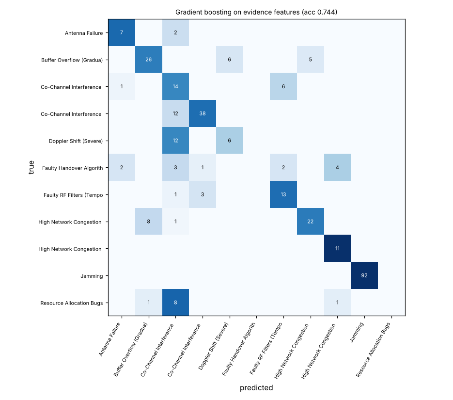
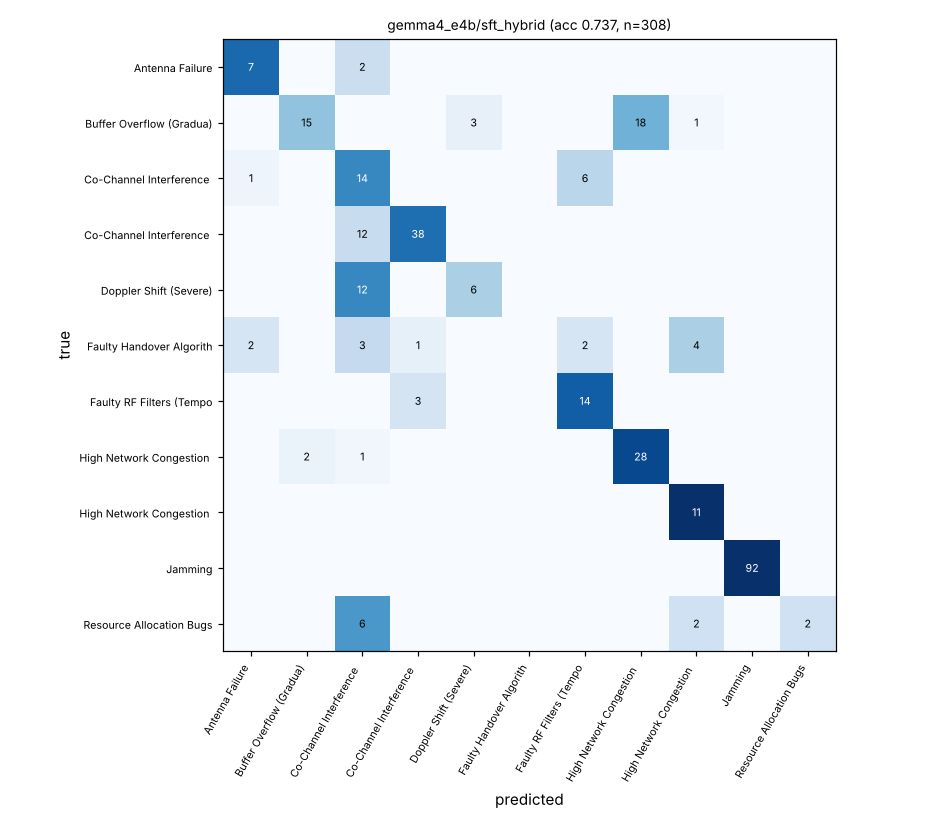
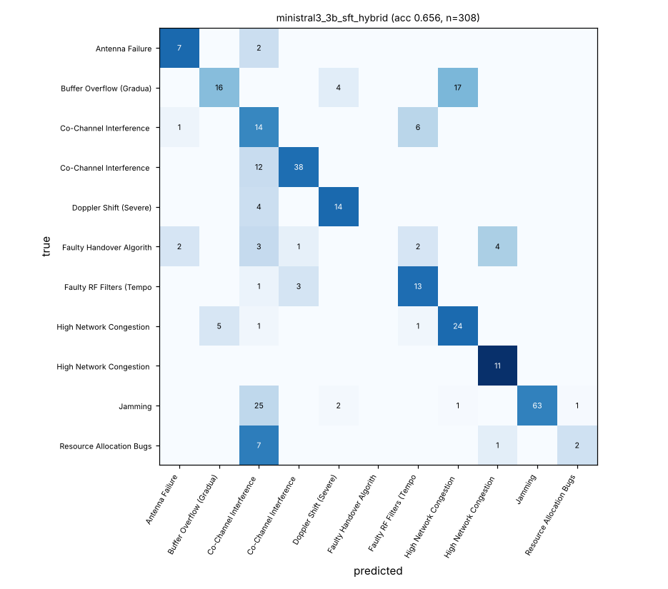
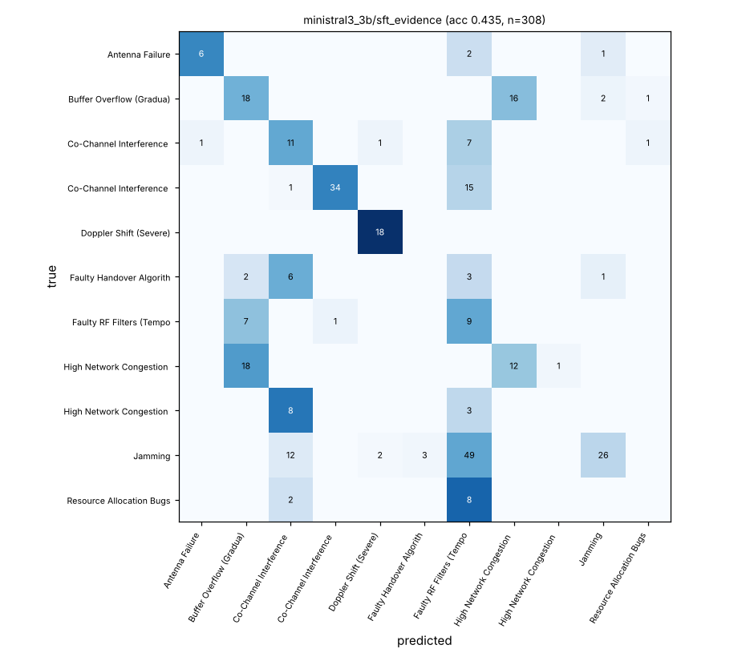

# telco-rca-llm

A small LLM that takes an **already-detected anomaly** in 5G KPIs and returns:

* the root cause,
* the KPIs that show it,
* an explanation,
* a troubleshooting-ticket resolution,

as strict, schema-validated JSON. Fine-tuning runs on GPU (Kaggle T4). Deployment is CPU-only
(llama.cpp GGUF). It is a public proxy for a later internal project on operator data, so the core
package is dataset-agnostic and has no Kaggle dependency.

Data: [TelecomTS](https://huggingface.co/datasets/AliMaatouk/TelecomTS) (MIT), only the 1,235
anomalous windows (18 KPIs × 128 steps × 100 ms, 11 root causes, 12 recordings).

**Every number below is read from a committed file under `results/`.** Each table names its
source, and `results/systems.json` maps every system to its predictions file and the run that
produced it. Numbers from the literature are in a separate section and are never mixed into our
tables.

## TL;DR (honest version)

* **The classical baseline is not beaten on root cause.** LightGBM on the deterministic evidence
  features reaches 0.737 accuracy / 0.594 macro-F1 on the recording-held-out test set. The best LLM
  (Gemma 4 E4B, QLoRA, with GB's top-3 probabilities in the prompt) matches it: 0.737 / 0.590. It
  agrees with GB's top-1 on 91.6% of cases and fixes exactly as many GB errors (12) as it
  introduces (12) (`results/hybrid_analysis.json`). Without the GB probabilities, the fine-tuned LLMs
  reach only 0.325-0.435 accuracy.
* **Zero-shot small LLMs are useless here**, even with the evidence block: 0.016-0.192 accuracy,
  and Gemma 4 E4B collapses onto one class. A zero-shot 26B MoE (Gemma 4 26B-A4B, Q4 on CPU) gets
  0.065. That is consistent with the ~0.12-0.28 the TelecomTS paper reports for frontier LLMs.
* **Fine-tuning still buys the output contract.** 100% valid JSON (vs 38-53% for zero-shot
  Ministral), the right KPI vocabulary (KPI set-F1 0.82-0.93), ticket-style resolutions, and
  explanations whose cited KPIs are ≥99.8% in the evidence's deviating list (zero-shot: 40-75%).
* **TelecomTS can't measure explanation quality well.** Each class has exactly one ticket and one
  affected-KPI list (`results/data_audit.json`). Resolution and KPI metrics therefore mostly
  re-measure classification, and a non-LLM "GB + ticket template" system already scores as high as
  the best LLM on every text metric. Whether the LLM adds value beyond templated explanations can
  only be judged by humans: `results/review/review_sheet.csv` (30 cases, blind A/B: LLM vs template).
* **The window-level random split leaks.** Windows overlap by 75%. A window-level random split, as in
  TelecomTS' own `run.py`, gives GB 0.951 accuracy instead of 0.737 (`results/baseline/gb_random_split`).
* **CPU deployment works.**
  * Q8_0 GGUFs are essentially lossless vs GPU fp16: 98-99% of root causes agree.
  * Q4_K_M loses 0.006-0.016 accuracy on the full test set.
  * One 4-core CPU handles a case in 44-86 s, i.e. 42-82 cases per hour per machine, with 4-8 GB RAM.
  * Details in [CPU deployment](#cpu-deployment-llamacpp-gguf).

## Data and split

Details, provenance and caveats: [docs/DATA.md](docs/DATA.md). In short:

* Only the anomalous windows are used, and the detector's anomalous interval is given. The
  dataset's `description` field is **not** used: it was generated from the anomaly symptoms, so it
  leaks the label.
* **Reasoning traces are not used.** The paper (App. F.1) states they were generated with **Qwen3-32B**,
  a Chinese-origin model, so per the project rules training uses the tickets only. The tickets
  were generated with GPT-4.1, with human review.
* **Split:** the official code (`src/run.py`) uses a window-level random 80/20 split. That leaks
  (75% window overlap), so we use a seeded, label-stratified **group split by recording**
  (`configs/splits/telecomts_grouped_seed42.json`; no recording appears on both sides). It was found
  by exhaustive search over the 12 recordings.

| split | recordings | windows | Ant.Fail | BufOvf | CCI mild | CCI sev | Doppler | Handover | RF filt | Cong. grad | Cong. spike | Jamming | ResAlloc |
|---|---|---|---|---|---|---|---|---|---|---|---|---|---|
| train | 9 | 927 | 98 | 101 | 125 | 64 | 68 | 52 | 83 | 62 | 37 | 187 | 50 |
| test | 3 (A/YouTube, B/YouTube, jammer/YouTube) | 308 | 9 | 37 | 21 | 50 | 18 | 12 | 17 | 31 | 11 | 92 | 10 |

Source: `results/data_stats.json`.

Caveat: the Jamming class comes from three separate jammer recordings that contain nothing else.
It can be recognised from recording-level background differences rather than the interference
signature, so we also report accuracy without Jamming (the paper's RCA code drops it too).

## Architecture

```
 detected anomaly (KPI window + detector interval)
        │
        ▼
 ┌──────────────────────────┐   per KPI: baseline (in-window normal steps → same cell's unflagged
 │ evidence extraction      │   history → comparable normal cell), robust z of segment median,
 │ (deterministic, numpy)   │   relative change, shape (step/ramp/spikes/oscillating/variance),
 └──────────┬───────────────┘   reaction lag, % of segment outside the band, categorical shifts
            │ text block (~450 tokens)          │ feature vector (198 features)
            ▼                                   ▼
 ┌──────────────────────────┐       ┌──────────────────────────┐
 │ small LLM (QLoRA SFT)    │◄──────│ LightGBM (root cause)    │  hybrid: top-3 class probabilities
 │ Gemma 4 E4B / Ministral 3│ top-3 └──────────────────────────┘  go into the prompt
 └──────────┬───────────────┘
            ▼
 strict JSON {root_cause, affected_kpis, explanation, resolution}  ── jsonschema-validated
            │
            ▼
 GGUF (Q8_0 / Q4_K_M) → llama.cpp llama-server, CPU only
```

An example evidence block (the actual model input) is in `results/examples.md`.

**SFT target.**
* `root_cause` and `affected_kpis` come from the dataset labels.
* `resolution` is the ticket's Resolution.
* `explanation` is the ticket's Issue and Root Cause sentences plus one sentence generated
  deterministically from this window's evidence: which affected KPIs deviate, in which direction,
  with the numbers, the shape and the steps involved.

No teacher LLM is used anywhere.

Package layout:
* `src/telco_rca/data/`: adapter interface, the TelecomTS and synthetic adapters, and the grouped
  split.
* `src/telco_rca/evidence.py`: evidence extraction.
* `src/telco_rca/prompts.py`, `src/telco_rca/schema.py`: prompts and the output contract.
* `src/telco_rca/baseline.py`: the classical baseline.
* `src/telco_rca/llm/`: `train.py`, `hf_infer.py`, `export.py`, `cpu_infer.py`.
* `src/telco_rca/metrics.py`: metrics.
* `configs/`: configuration (YAML).
* `kaggle/`: kernels.
* `tests/`: tests.

CLI: `telco-rca {prepare, baseline, build-sft, train, infer-hf, export-gguf, infer-cpu, evaluate, review-sheet, report}`.

## Models

Policy and verification details: [docs/MODELS.md](docs/MODELS.md). No Chinese-origin model is used
anywhere (base, teacher, judge, embedding). BERTScore uses `roberta-large`.

| model | origin / licence | QLoRA on one T4 (fp16, measured) | fp16 overflow probe | llama.cpp GGUF |
|---|---|---|---|---|
| Gemma 4 E4B-it | Google / Apache-2.0 | 10.0 GB peak, ~101 min for 2 epochs. The 2.82B-param per-layer embedding table must stay on CPU; without that it OOMed even split over 2×T4 | finite (loss 3.81-3.88) | yes, our merged fine-tune converted and quantised |
| Ministral 3 3B Instruct 2512 (BF16 copy) | Mistral AI / Apache-2.0 | 12.4-12.8 GB peak (batch 4), 74-80 min | finite | yes (VM and Kaggle builds bit-identical, `results/gguf_ministral3.sha256`) |
| Granite 4.1 3B | IBM / Apache-2.0 | 5.6 GB peak (6-step verification only) | finite | converter supports it; not trained (GPU budget) |

Sources: `results/gpu_*/**/train_log.json`, `results/gpu_verify/`.

Neither model needed the fp32 fallback. The known Gemma-on-T4 fp16 overflow did not show up for
Gemma 4 E4B, either in the probe or during 2 epochs of training.

## Results (test set: 308 windows from 3 held-out recordings)

All systems use the same test set. Exceptions: the raw-series zero-shot rows, whose longest prompts
ran out of memory or GPU budget (n is given).

### Root cause, KPIs, JSON

| group | system | n | acc | macro-F1 | acc excl. Jamming | KPI set-F1 | JSON valid | schema valid | grounded KPI mentions |
|---|---|---|---|---|---|---|---|---|---|
| classical | majority class | 308 | 0.299 | 0.042 | 0.000 | – | – | – | – |
| classical | **LightGBM on evidence features** | 308 | **0.737** | **0.594** | 0.625 | – | – | – | – |
| classical | GB + ticket template (full JSON, no LLM) | 308 | 0.737 | 0.594 | 0.625 | 0.949 | 1.000 | 1.000 | 1.000 |
| zero-shot | Gemma 4 E4B, raw series | 260 | 0.185 | 0.028 | 0.286 | 0.460 | 1.000 | 1.000 | 0.403 |
| zero-shot | Gemma 4 E4B, evidence | 308 | 0.192 | 0.057 | 0.273 | 0.490 | 1.000 | 1.000 | 0.746 |
| zero-shot | Ministral 3 3B, raw series | 288 | 0.021 | 0.023 | 0.031 | 0.190 | 0.378 | 0.375 | 0.246 |
| zero-shot | Ministral 3 3B, evidence | 308 | 0.016 | 0.015 | 0.023 | 0.253 | 0.532 | 0.532 | 0.739 |
| zero-shot (CPU) | Gemma 4 26B-A4B Q4_0, evidence | 308 | 0.065 | 0.046 | 0.065 | 0.444 | 1.000 | 0.994 | 0.732 |
| QLoRA SFT | Gemma 4 E4B, evidence | 308 | 0.325 | 0.300 | 0.440 | 0.821 | 1.000 | 0.997 | 1.000 |
| QLoRA SFT | Ministral 3 3B, evidence | 308 | 0.435 | 0.388 | 0.500 | 0.855 | 1.000 | 1.000 | 0.998 |
| hybrid | **Gemma 4 E4B, evidence + GB top-3** | 308 | **0.737** | 0.590 | 0.625 | 0.925 | 1.000 | 1.000 | 0.998 |
| hybrid | Ministral 3 3B, evidence + GB top-3 | 308 | 0.656 | 0.584 | **0.644** | 0.919 | 1.000 | 0.994 | 1.000 |
| reference | SFT targets themselves (oracle) | 308 | 1.000 | 1.000 | 1.000 | 1.000 | 1.000 | 1.000 | 1.000 |

Source: `results/summary.md` (generated by `scripts/evaluate_all.sh` → `telco-rca report`).

How to read the columns:
* "Grounded KPI mentions" is the fraction of KPI names cited in the explanation that are in the
  evidence's deviating list (|z| ≥ 3). It is a hallucination check.
* "Schema valid" is stricter than "JSON valid": exact label and KPI names, no extra keys.
* Gemma zero-shot predicts "Co-Channel Interference (Severe)" for 222 of 308 cases
  (`pred_distribution` in its `metrics.json`). Its 0.19 accuracy is mostly that one class.

### Explanation and resolution text vs the reference tickets

| system | expl ROUGE-L | expl BERTScore F1 | expl BERTScore (rescaled) | res ROUGE-L | res BERTScore F1 | res BERTScore (rescaled) |
|---|---|---|---|---|---|---|
| GB + ticket template | 0.338 | 0.855 | 0.139 | 0.805 | 0.973 | 0.840 |
| Gemma 4 E4B zero-shot, evidence | 0.145 | 0.845 | 0.079 | 0.132 | 0.872 | 0.240 |
| Ministral 3 3B zero-shot, evidence | 0.069 | 0.856 | 0.147 | 0.062 | 0.881 | 0.298 |
| Gemma 4 26B-A4B zero-shot (CPU) | 0.131 | 0.844 | 0.073 | 0.117 | 0.863 | 0.191 |
| Gemma 4 E4B SFT, evidence | 0.190 | 0.836 | 0.030 | 0.439 | 0.922 | 0.539 |
| Ministral 3 3B SFT, evidence | 0.225 | 0.843 | 0.068 | 0.544 | 0.937 | 0.625 |
| Gemma 4 E4B hybrid | 0.329 | 0.853 | 0.127 | 0.767 | 0.969 | 0.818 |
| Ministral 3 3B hybrid | 0.302 | 0.850 | 0.112 | 0.738 | 0.963 | 0.779 |
| oracle (SFT targets) | 0.397 | 0.862 | 0.185 | 1.000 | 1.000 | 1.000 |

Source: `results/summary.md`.

* The explanation reference is the ticket's Issue + Symptoms + Root Cause text. Our target
  deliberately replaces the generic Symptoms with case-specific evidence, so even the oracle
  reaches only 0.397 ROUGE-L.
* Raw BERTScore (roberta-large) is compressed into 0.83-0.87 for every system. The
  baseline-rescaled column separates systems better.
* Raw-series zero-shot rows are in `results/summary.md`.

### Per-class F1 and confusion matrices

| root cause (test n) | LightGBM | Gemma hybrid | Ministral hybrid | Gemma SFT evid. | Ministral SFT evid. |
|---|---|---|---|---|---|
| Antenna Failure (9) | 0.737 | 0.737 | 0.737 | 0.455 | 0.750 |
| Buffer Overflow (Gradual Buildup) (37) | 0.692 | 0.556 | 0.552 | 0.000 | 0.439 |
| Co-Channel Interference (Mild) (21) | 0.394 | 0.394 | 0.311 | 0.230 | 0.361 |
| Co-Channel Interference (Severe) (50) | 0.826 | 0.826 | 0.826 | 0.769 | 0.800 |
| Doppler Shift (Severe) (18) | 0.429 | 0.444 | 0.737 | 0.714 | **0.923** |
| Faulty Handover Algorithm (Too Frequent) (12) | 0.000 | 0.000 | 0.000 | 0.000 | 0.000 |
| Faulty RF Filters (Temporal) (17) | 0.700 | 0.718 | 0.667 | 0.194 | 0.159 |
| High Network Congestion (Gradual Buildup) (31) | 0.604 | **0.727** | 0.658 | 0.324 | 0.407 |
| High Network Congestion (Sudden Spike) (11) | 0.815 | 0.759 | 0.815 | 0.036 | 0.000 |
| Jamming (92) | 1.000 | 1.000 | 0.813 | 0.101 | 0.426 |
| Resource Allocation Bugs (10) | 0.333 | 0.333 | 0.308 | 0.480 | 0.000 |

Source: `results/summary.md`.

| LightGBM | Gemma 4 E4B hybrid | Ministral 3 3B hybrid | Ministral 3 3B SFT (evidence) |
|---|---|---|---|
|  |  |  |  |

Every evaluated system has its own `confusion.png` next to its `predictions.jsonl`.

### Does the LLM add anything in the hybrid?

| hybrid model | agrees with GB top-1 | answer within GB top-3 | LLM right, GB wrong | LLM wrong, GB right |
|---|---|---|---|---|
| Gemma 4 E4B | 0.916 | 0.994 | 12 | 12 |
| Ministral 3 3B | 0.808 | 0.997 | 17 | 42 |

Source: `results/hybrid_analysis.json`.

The fine-tuned LLM almost always picks from GB's top 3, and mostly GB's top 1. On classification it
is at best a neutral re-ranker. Its local wins (Doppler for Ministral, Gradual-Buildup Congestion for
Gemma) are offset elsewhere.

## CPU deployment (llama.cpp GGUF)

Both hybrid fine-tunes were merged into their base models in fp16, converted with llama.cpp
`convert_hf_to_gguf.py` and quantised to Q8_0 and Q4_K_M. The Ministral GGUFs built on Kaggle and
on this VM are bit-identical (`results/gguf_ministral3.sha256`).

Inference runs through `llama-server`, one request at a time, 4 threads, greedy decoding. Prompts are
rendered with the model's own chat template and sent as token ids, so they are byte-identical to the
GPU fp16 runs.

The rows below cover three settings:
* **Kaggle CPU kernel** (4 vCPU Xeon @ 2.20 GHz, 30 GB RAM): the full 308-case test set.
* **This VM** (4 vCPU Xeon @ 2.80 GHz with AVX-512, 15 GB RAM): a fixed, seeded 100-case subset
  (`results/cpu_subset_ids.json`), run strictly one job at a time.
* **Model RAM:** a separate 10-case run per GGUF on this VM with the host prompt cache disabled
  (`--cache-ram 0`). The main runs used llama.cpp's default 8 GB prompt cache, which dominates
  their peak RSS (~12-16 GB) without changing speed.

| model | quant | GGUF GB | where | n | acc GPU fp16 (same cases) | acc CPU | Δ | agreement with fp16 | schema valid | prompt / output tokens | s/case (mean, p95) | cases/hour | model RAM GB (`--cache-ram 0`) |
|---|---|---|---|---|---|---|---|---|---|---|---|---|---|
| Gemma 4 E4B hybrid | Q4_K_M | 5.30 | Kaggle CPU | 308 | 0.737 | 0.721 | −0.016 | 0.977 | 0.948 | 800 / 217 | 86.1 / 116.6 | 42 | 7.15 |
| Gemma 4 E4B hybrid | Q8_0 | 7.97 | Kaggle CPU | <!--G8N--> | <!--G8ROW--> |
| Gemma 4 E4B hybrid | Q4_K_M | 5.30 | this VM | 100 | 0.850 | 0.790 | −0.060 | 0.940 | 0.970 | 805 / 219 | 52.6 / 68.4 | 68 | 7.15 |
| Gemma 4 E4B hybrid | Q8_0 | 7.97 | this VM | 100 | 0.850 | 0.840 | −0.010 | 0.990 | 1.000 | 805 / 209 | 85.1 / 116.1 | 42 | 7.85 |
| Ministral 3 3B hybrid | Q4_K_M | 2.15 | Kaggle CPU | 308 | 0.656 | 0.649 | −0.006 | 0.935 | 0.997 | 838 / 217 | 64.8 / 102.6 | 56 | 4.32 |
| Ministral 3 3B hybrid | Q8_0 | 3.65 | Kaggle CPU | 308 | 0.656 | 0.672 | +0.016 | 0.984 | 0.994 | 838 / 215 | 76.6 / 115.7 | 47 | 4.36 |
| Ministral 3 3B hybrid | Q4_K_M | 2.15 | this VM | 100 | 0.770 | 0.760 | −0.010 | 0.930 | 1.000 | 844 / 225 | 44.0 / 63.4 | 82 | 4.32 |
| Gemma 4 26B-A4B zero-shot (reference) | Q4_0 (Google QAT) | 14.44 | Kaggle CPU | 308 | – | 0.065 | – | – | 0.994 | 746 / 192 | 78.0 | 46 | 28.2 (default cache) |

Sources: `results/cpu_report.md` / `.json` (`scripts/cpu_report.py`), the `results/cpu_*` run
directories (`predictions.run.json` records CPU, threads, load time and peak RSS), and
`results/cpu_vm_memory/`.

Reading it:

* **Q8_0 is essentially lossless.**
  * Gemma Q8_0 agrees with GPU fp16 on 99% of root causes.
  * Ministral Q8_0 agrees on 98.4%, with +0.016 accuracy, which is noise in the other direction.
* **Q4_K_M costs a little.**
  * Accuracy drops 0.006-0.016 on the full test set (0.06 on Gemma's 100-case VM subset).
  * Agreement with fp16 is 93-98%.
  * For Gemma, Q4_K_M sometimes repeats a KPI in `affected_kpis` (16 of 308 outputs), and the
    strict schema rejects these. The root cause is unaffected. A dedupe step, or llama.cpp's
    JSON-schema-constrained decoding (`json_schema` in the `/completion` request), removes this
    failure mode. It was not used in these measurements.
* **Cost per case.** Every case is ~800 prompt tokens plus ~215 output tokens. Generation (~5-6 tok/s
  on 4 cores) dominates.
  * Ministral 3 3B Q4_K_M: 44 s/case on this VM (82 cases/hour), 65 s on Kaggle's slower vCPUs.
  * Gemma 4 E4B Q4_K_M: 53 s/case on this VM, 86 s on Kaggle.
  * One 4-core machine therefore handles ~1,000-2,000 incidents per night. Throughput scales almost
    linearly with cores, and per-case latency falls with the core count up to the memory-bandwidth
    limit.
* **RAM.** With the prompt cache off, Ministral needs ~4.3 GB and Gemma 4 E4B ~7-8 GB. The 26B-A4B
  MoE needs a 14.4 GB file and peaked at 28 GB with the default cache, and gives nothing in return here.
* **Deployment recommendation.** Ministral 3 3B Q8_0 (3.65 GB, ~4.4 GB RAM, near-identical to fp16)
  or Gemma 4 E4B Q8_0 (7.97 GB, ~7.9 GB RAM). Gemma's hybrid has +0.081 accuracy over Ministral's at GPU fp16, at equal macro-F1 (0.590 vs 0.584). Always run
  it behind the GB classifier, and fall back to the GB+template answer if the JSON is not
  schema-valid.


## 10 example outputs

From Gemma 4 E4B hybrid: 5 correct and 5 wrong, a seeded pick spread over classes. The full
evidence blocks, GB probabilities and JSON are in [results/examples.md](results/examples.md).

| # | true root cause | predicted | case-specific part of the generated explanation |
|---|---|---|---|
| ok 1 | High Network Congestion (Sudden Spike) | High Network Congestion (Sudden Spike) | In this window (steps 0-3 (0.4 s)): UL_NPRB up (5 -> 9.3, z=+86.0, step up). |
| ok 2 | Jamming | Jamming | In this window (steps 0-127 (12.8 s)): DL_BLER up (0 -> 0.00584, z=+99+, ramp up). |
| ok 3 | Faulty RF Filters (Temporal) | Faulty RF Filters (Temporal) | In this window (steps 0-36 (3.7 s)): DL_BLER up (0 -> 0.00104, z=+99+, step up); UL_BLER up (0 -> 9.01e-04, z=+99+, step up). |
| ok 4 | High Network Congestion (Gradual Buildup) | High Network Congestion (Gradual Buildup) | In this window (steps 84-122 (3.9 s)): DL_BLER up (0 -> 9.14e-04, z=+99+, step up); UL_BLER up (0 -> 8.17e-04, z=+99+, step up); PRB_Utilization_UL up (0 -> 0.685, z=+18.1, step up); UL_NumberOfPackets up (0 -> 13.4, z=+6.9, step up). |
| ok 5 | Resource Allocation Bugs | Resource Allocation Bugs | In this window (steps 13-127 (11.5 s)): RX_Bytes down (209 -> 81, z=-5.4, step down). |
| wrong 1 | High Network Congestion (Gradual Buildup) | Buffer Overflow (Gradual Buildup) | In this window (steps 0-127 (12.8 s)): DL_BLER up (0 -> 0.00176, z=+99+, step up); PRB_Utilization_UL up (0.0289 -> 16.9, z=+99+, step up); UL_NumberOfPackets up (0 -> 221, z=+99+, step up); DL_NumberOfPackets up (0 -> 292, z=+17.7, ramp up). |
| wrong 2 | Faulty Handover Algorithm (Too Frequent) | High Network Congestion (Sudden Spike) | In this window (steps 61-70 (1 s)): UL_BLER up (5.97e-04 -> 0.0706, z=+79.1, ramp up); RX_Bytes up (49 -> 1,640, z=+99+, step up); PRB_Utilization_UL up (0.0472 -> 3.23, z=+45.5, step up); Estimated_UL_Buffer up (0 -> 940, z=+7.7, step up). |
| wrong 3 | Doppler Shift (Severe) | Co-Channel Interference (Mild) | In this window (steps 0-127 (12.8 s)): DL_MCS down (7 -> 6, z=-14.3, step down). |
| wrong 4 | Antenna Failure | Co-Channel Interference (Mild) | In this window (steps 80-127 (4.8 s)): RSRP down (-97.3 -> -102, z=-5.3, step down); RX_Bytes up (95 -> 142, z=+3.2, ramp down). |
| wrong 5 | Buffer Overflow (Gradual Buildup) | High Network Congestion (Gradual Buildup) | In this window (steps 0-112 (11.3 s)): PRB_Utilization_DL up (0 -> 69, z=+99+, step up); PRB_Utilization_UL up (0.0472 -> 45.7, z=+99+, step up); UL_NPRB up (5 -> 34.8, z=+99+, step up); DL_BLER up (2.00e-05 -> 0.0037, z=+99+, step up). |

Source: `results/examples_table.md` (`scripts/make_examples.py`).


## Human review

`results/review/review_sheet.csv` holds 30 test cases, round-robin over classes. Each row has the
evidence block and two anonymised outputs in random order:
* the Gemma 4 E4B hybrid LLM, and
* the non-LLM GB + ticket template system.

The reviewer rates each output for:
* root cause plausible (Y/N),
* explanation faithful (1-5),
* resolution actionable (1-5),
* which output they prefer.

`results/review/review_key.csv` (keep it away from the reviewer) maps rows to case, ground truth
and system. This is the only meaningful test of whether the LLM's explanation adds value beyond the
template on this dataset.

## Published numbers (context only, not comparable)

Different splits, class sets and inputs; listed only for orientation:

* **TelecomTS paper (arXiv 2510.06063), Table 4, RCA accuracy.** GPT-4.1 0.215 / 0.227 (without /
  with context); Claude 3.7 Sonnet 0.115 / 0.245; o4-mini 0.245 / 0.275; DeepSeek-R1 0.145 / 0.261;
  TimesNet 0.685; Toto 0.848; Toto+Qwen-3-4B 0.826. They use their window-level random split
  (which leaks, see above) and the 10 synthetic classes without Jamming.
* **SEKA-FT (arXiv 2609.02805), Table I, TelecomTS.** ICL 1.5B / 7B / 32B 0.033 / 0.041 / 0.061
  accuracy; LSTM 0.115; SFT + structured input 0.132; SEKA-FT 0.647 accuracy and 0.615 macro-F1
  (Qwen2.5-1.5B base).

## Conclusions

1. **Where the classical baseline wins.** On root cause. LightGBM on our evidence features is the
   best or joint-best classifier. It trains in seconds on CPU and is the only system that gets
   Jamming perfectly. That is partly because it can exploit recording-level offsets that the
   prose evidence hides. No LLM variant improves on it in accuracy. The hybrid only matches it,
   because it learns to copy GB's top-1. If the goal is the root-cause label, deploy GB.
2. **Does the LLM add value beyond the explanation?** Not on classification. Its real
   contributions are:
   * a fixed, valid JSON contract, whereas zero-shot models break it or collapse onto one class;
   * explanations whose cited KPIs are ≥99.8% supported by the evidence;
   * resolutions in ticket style.

   On TelecomTS the tickets and KPI lists are per-class constants, so a lookup template does the
   same. The LLM can only pay off on data where explanations and resolutions vary per incident.
   That needs real tickets (see ADAPTING.md), plus the human review above to measure it.
3. **The evidence block matters more than the model size.** On raw series, small models are at or
   below chance. With evidence and SFT they reach 0.33-0.44. With the classical model's opinion in
   the prompt they reach 0.66-0.74. A 26B zero-shot MoE does not substitute for any of this.
4. **What transfers to real operator KPIs (1-15 min aggregates).**
   * The pipeline (adapter → evidence → JSON) and the evidence statistics are scale-free (robust z
     against a baseline, shape, onset lag). They carry over unchanged.
   * The baseline does not carry over. Real counters are dominated by daily and weekly
     seasonality, so the reference profile must be built per hour-of-week from weeks of history
     (ADAPTING.md §1). The 5-minute history used here does not apply.
   * The synthetic TelecomTS anomalies are injected with fixed functional shapes per class. That
     makes them far more separable than real incidents, where multiple causes overlap and labels
     are noisy. Expect lower accuracy and more value from retrieval of past tickets and vendor
     documentation.
   * Group splits by cell or site and by time are mandatory: window-level splits inflated accuracy
     from 0.737 to 0.951 here.
   * The deployment numbers (tokens, seconds per case, RAM) carry over almost directly, since the
     evidence block length does not depend on the sampling rate.
5. **CPU-only is practical for batch use, not for interactive use.**
   * Throughput is 42-82 cases per hour on a 4-core VM, i.e. ~1,000-2,000 incidents in an overnight
     batch.
   * Q8_0 is the safe default. Q4_K_M is 15-40% faster (Gemma 53 vs 85 s/case on this VM; Ministral
     65 vs 77 s on Kaggle) and smaller, at a small accuracy cost.
   * Put the GB classifier in front, and fall back to its template answer when the JSON is invalid.

## GPU budget and failed runs (transparency)

Kaggle reported **10.52 GPU-hours** used (`results/kaggle_quota_after_gpu_runs.txt`), under the
12-hour limit. That includes these failures:

* a prompt nondeterminism caught by the content-hash check (`PYTHONHASHSEED`-dependent tie-break, fixed);
* Gemma QLoRA OOMs. Fixed by keeping its 2.8B-parameter per-layer embedding table on CPU and
  computing logits only for the answer span;
* a Hugging Face 429 rate limit;
* device mismatches in 2-GPU inference.

Every failed run's logs are kept under `results/gpu_*_run*`, `results/gpu_gemma4_eval_run1` and
`results/failed_attempts/`. Granite 4.1 3B was verified (6 steps) but not trained, because the
budget was used up.

## Reproduce

```bash
pip install -e ".[eval,dev]" torch            # CPU torch is enough for everything except training
telco-rca prepare --stats-out results/data_stats.json --check-hash results/data_stats.json
telco-rca baseline --out results/baseline --random-split --save-model
python scripts/data_audit.py && pytest -q
```

GPU and CPU runs, with a `KAGGLE_API_TOKEN` set:

```bash
scripts/kaggle_run.sh gpu telco-rca-gpu-gemma4     gpu_gemma4     '{"models":["gemma4_e4b"]}'
scripts/kaggle_run.sh gpu telco-rca-gpu-ministral3 gpu_ministral3 '{"models":["ministral3_3b"]}'
scripts/kaggle_run.sh cpu telco-rca-export-gemma4  export_gemma4 \
   '{"task":"export","model":"gemma4_e4b","adapter_glob":"gemma4_e4b/sft_hybrid/adapter"}' <user>/telco-rca-gpu-gemma4
DATASETS=<user>/telco-rca-prompts scripts/kaggle_run.sh cpu telco-rca-cpu-gemma4-q4 cpu_kaggle_gemma4_hybrid_q4_k_m \
   '{"task":"infer","model":"gemma4_e4b","gguf_glob":"*Q4_K_M.gguf","mode":"hybrid","examples_glob":"hybrid_test.jsonl"}' <user>/telco-rca-export-gemma4
python scripts/kaggle_download.py <user>/telco-rca-export-gemma4 ~/gguf/gemma4_hybrid 'Q4_K_M|Q8_0'   # streams multi-GB files
scripts/cpu_vm_runs.sh                     # CPU runs on this machine, one at a time
scripts/evaluate_all.sh && python scripts/cpu_report.py --gpu-ref <gpu fp16 predictions> --cpu results/cpu_*
```

* `<user>/telco-rca-prompts` is a private Kaggle dataset holding the hash-verified test prompts
  (`results/prompt_files.sha256`). It makes the CPU runs see byte-identical prompts to the GPU runs.
* Without Kaggle, the same CLI runs on any CUDA box and any CPU server: [ADAPTING.md](ADAPTING.md)
  §4-5. The kernels are thin job runners around these commands.
* CI (`.github/workflows/ci.yml`) runs lint and the CPU tests: no recording leakage, evidence on
  synthetic series with known answers, JSON schema, determinism, and a tiny CPU LoRA end-to-end run.

Next steps for an operator deployment (new adapter, ~200-incident annotation guide, own-GPU
training, CPU serving, and where 3GPP and vendor-manual retrieval plugs in) are in
[ADAPTING.md](ADAPTING.md).
